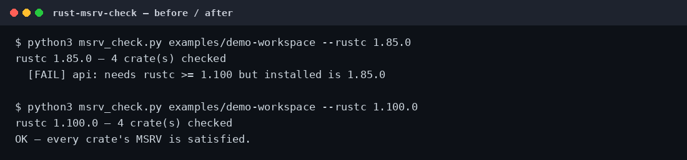

# rust-msrv-check



One crate in your workspace bumps its MSRV and CI on the pinned toolchain breaks with a cryptic error. This script finds that crate first. It checks a 4-crate workspace in a median 71 ms, Python startup included, measured over 7 runs on the demo workspace below.

## Why now

Rust 1.100.0 shipped on November 12, 2026, with the never type finally stable after 10 years of attempts. Every new stable release pushes crates to raise their `rust-version`, and a workspace pinned to an older toolchain is the thing that breaks. Rust is also the hot language on GitHub this week. `rust-anything` (rewrite an app in Rust piece by piece) sits at 6.6k stars and gains about 1,478 a day, and `WinRust` (a Windows shell in Rust) sits at 741 stars and gains about 376 a day, both per Trendar on November 21, 2026. More Rust code in the wild means more crates whose MSRV drifts past the toolchain people actually run.

## Quick start

Requires Python 3.11 or newer. No dependencies, no install step.

```bash
git clone https://github.com/Mahgal/rust-msrv-check.git
cd rust-msrv-check
python3 msrv_check.py examples/demo-workspace --rustc 1.85.0   # exit 1: api needs 1.100
python3 msrv_check.py examples/demo-workspace --rustc 1.100.0  # exit 0: all clear
```

Against your own workspace:

```bash
python3 msrv_check.py .                    # uses installed rustc
python3 msrv_check.py . --rustc 1.85.0     # compare against a pinned version
python3 msrv_check.py . --format json      # machine-readable output
```

## Example output

The block below is the real output of the two demo commands above, byte for byte. The demo workspace has four crates. `api` needs Rust 1.100, `core` and the root crate need 1.85, `cli` needs 1.74.

```text
$ python3 msrv_check.py examples/demo-workspace --rustc 1.85.0
rustc 1.85.0 — 4 crate(s) checked
  [FAIL] api: needs rustc >= 1.100 but installed is 1.85.0

$ python3 msrv_check.py examples/demo-workspace --rustc 1.100.0
rustc 1.100.0 — 4 crate(s) checked
OK — every crate's MSRV is satisfied.
```

## What it checks

- Walks the directory tree for every `Cargo.toml`, including workspace members and standalone crates. `target/` and `.git/` are skipped.
- Reads each crate's `rust-version` from `[package]`, falling back to `[workspace.package]` when the crate itself sets none.
- Compares versions exactly. A crate fails when its required version is newer than the rustc you compare against.
- Warns instead of failing for two cases: a crate with no `rust-version` set, and a crate still on edition 2015 or 2018.
- Prints `--format json` for CI parsing. The JSON carries the rustc version, the crate count, an `ok` flag, and the problem and warning lists.

Exit codes: `0` means every crate's MSRV is satisfied (warnings may still print), `1` means at least one crate needs a newer rustc, `2` means bad input (an unreadable version string, or no rustc on PATH when `--rustc` is not given).

## Limitations

- Comparison is exact versions only. There is no semver range handling. A `rust-version` the parser cannot read as `X.Y` or `X.Y.Z` is reported as a problem, not skipped.
- `rust-version.workspace = true` is not resolved. The tool reports it as an invalid `rust-version`. Set the version literally on each crate if you use this tool.
- A directory with no `Cargo.toml` at all reports `0 crate(s) checked` and exits 0. It does not error.
- Without `--rustc`, `rustc` must be on PATH. If it is missing, the tool exits 2 and tells you to pass `--rustc`.
- It only reads `Cargo.toml` files. It never runs `cargo`, so it cannot catch an MSRV implied by a dependency.

## Tests

```bash
python3 -m unittest discover -s tests
```

17 tests, stdlib only. They cover the core check, the CLI exit codes, JSON output, and the edge cases above: malformed `rust-version`, malformed TOML, missing `rust-version`, old editions, `target/` skipping, inherited `rust-version`, and an empty directory.

## License

MIT. See [LICENSE](LICENSE).
